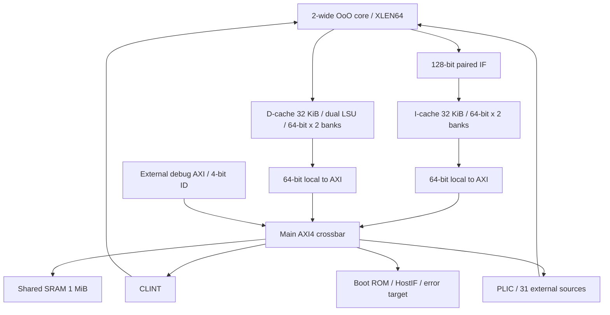

# RV23 개발 시작본

현재 목표는 공식 RVA23S64 전체 구현이다. 이전 RV32 전환 지침은 사용자의
2026-10-29 확정 지시로 대체됐다. default XLEN=64, 구현 물리주소는 32 bit다.
필수 기능과 검증 상태는 [RVA23_TARGET](RVA23_TARGET.md)에 기록한다.
S모드/Sv39, D/Zfhmin/Zfa, 정수·FP 미정렬 접근과 V/Zvfhmin/Zvbb를 연결했다.
V는 VLEN128/ELEN64이며 ROB head에서 실행한다. H의 HS/VS/VU 상태·2단계 변환·가상 IRQ와
HPM overflow를 통합했다. 전체 아키텍처 검증과 타이밍 계약 검증 등 필수 작업이 남아 있다.
공식 RVA23 호환성 완료나 timing sign-off를 주장하지 않는다.

## 메모리 계약

| 구역 | 시작 | 끝(포함) | 속성 |
|---|---|---|---|
| Boot ROM | 0x00001000 | 0x00001fff | 읽기 전용, 명령 fetch 허용 |
| CLINT | 0x02000000 | 0x0200ffff | uncached MMIO |
| PLIC | 0x0c000000 | 0x0c3fffff | uncached MMIO |
| HostIF | 0x10000000 | 0x10000fff | uncached MMIO |
| SRAM | 0x80000000 | 0x800fffff | 공용 1 MiB, I/D cacheable |
| 나머지 | — | — | DECERR |

I/D는 각각 32 KiB 데이터 용량, direct-mapped, 512 lines, 64-byte line이다.
tag/valid 용량은 32 KiB에 포함하지 않는다. 각 L1은 address[3]으로 나눈 64-bit
두 bank를 사용한다. bank당 2,048 × 64 bit = 16 KiB이며 한 line의 word 0/2/4/6과
1/3/5/7을 각각 저장한다. 각 bank는 1R1W이고 hit는 동기 읽기로 응답한다.
IF는 두 bank를 동시에 읽어 128 bit를 1 cycle에 돌려준다. 두 LSU는 서로 다른
bank이면 함께 수락하며, 같은 bank의 읽기는 round-robin으로 한 cycle씩 중재한다.
포트별 응답 슬롯을 두어 backpressure 동안 다른 포트의 bank 읽기가 응답을 바꾸지 않는다.

한 캐시당 miss/write-through engine은 하나이며 miss 시 8개의 64-bit AXI single-beat
read로 라인을 채운다. 다른 resident line의 hit는 이 engine 동작 중에도 가능하다.
burst 최적화와 다중 MSHR는 후속 작업이다. 데이터 SRAM payload는 reset clear하지 않는다.
D-cache는 write-through/no-write-allocate이고 쓰기 응답 전에는 성공을 반환하지 않는다.
빈 engine은 CPU 요청 수락 cycle에 downstream으로 요청을 전달한다. downstream이
막히면 payload를 저장해 SEND에서 유지한다. write/uncached read는 bridge의 registered
응답을 바로 CPU로 전달하고, CPU backpressure 시 포트별 응답 슬롯에 보관한다.
따라서 cache 앞뒤의 불필요한 두 대기를 줄이며 버스 응답을 기다리는 계약을 유지한다.
별도의 단일 LSU arbiter를 hit 경로에서 제거했다. 쓰기 완료를 기다리는 동안 같은
8-byte word만 잠그며, 같은 line의 다른 word에 대한 hit를 불필요하게 막지 않는다.
MMIO는 cache를 통과하되 allocate하지 않으며 원래 크기와 byte strobe를 보존한다.

어떤 master든 byte strobe가 있는 SRAM 쓰기를 수락하면 그 주소의 64-byte 라인만
I-cache에서 무효화한다. D-cache의 resident line은 그 실제 쓰기의 data/byte strobe를
해당 bank에 merge해 유지한다. write miss는 allocate하지 않는다. 같은 index라도 tag가
다르면 기존 라인을 유지한다. 채우는 중인 line에 대한 쓰기는 valid 설치를 취소한다.
다른 resident line의 snoop merge와 refill이 같은 bank write port를 요구하면 refill
응답에 backpressure를 걸어 두 쓰기를 보존한다. 이미 제시한 응답은 안정적으로 유지한다.
FENCE.I retire는 I-cache 전체를 무효화하고 기존
core의 frontend redirect/target-buffer flush를 사용한다. write-back dirty line은 없다.
외부 host/debug의 코드 변경은 core 초기 reset 상태에서 수행한다. 실행 중 DMA에 대한
다중 master coherent-memory/atomicity 계약이나 멀티코어 일관성 프로토콜은 제공하지 않는다.

## 인터럽트와 초기 기동

CLINT MSIP/MTIP와 64-bit mtime, PLIC MEIP가 core에 연결된다. 외부 IRQ는 같은
clock domain의 level 입력이다. 비동기 핀 동기화는 chip wrapper가 담당한다.
RV64 구성은 M/HS/VS/U/VU 모드, supervisor delegation, Sstc/가상 timer 및 HPM
overflow IRQ를 연결한다. CLINT mtime/mtimecmp는 32-bit 접근과 정렬된 64-bit 접근을
지원한다. AIA는 별도 선택 확장이며 현재 구현하지 않았다. PLIC 자체가 RVA23의 완전한 플랫폼 규격을 뜻하지 않는다.

global rst_ni를 해제하되 core_run_i=0으로 core를 reset에 유지한 동안 외부 AXI로
SRAM을 적재할 수 있다. bus를 drain한 뒤 core_run_i=1로 실행한다. 기본 reset/trap
vector는 SRAM 시작이다. core_run_i는 기동 제어이며 실행 중 transaction abort/reset에
사용하지 않는다. reset 후 SRAM 내용은 보존되지만 초기 전원 상태는 미정이다.
시뮬레이션에서는 SRAM_INIT_FILE, 선택적으로 BOOTROM_INIT_FILE을 지정한다.

## 디버그 경계

debug_halt_req_i는 기존 backend의 새 dispatch를 차단한다. ROB와 LSU가 drain하고
캐시/IF bus가 quiescent이면 debug_halted_o를 올린다. 요청을 내리면 재개한다.
IF adapter는 halt 동안 새 fetch 수락을 막고, 이미 수락한 fetch는 정상적으로 drain한다.
trace port와 debug_axi_s가 외부 관측/메모리 접근 경계다. debug AXI ID_WIDTH는 4,
system target ID_WIDTH는 6이다. halt로 새 dispatch가 중단돼도 이미 실행 중인 연산은
완료되므로 즉시 정지는 아니다. 명령어에 의한 원래 PC 경계의 표준 debug 진입도 아니다.

**JTAG DTM, DMI, 표준 Debug Module, DCSR/DPC, GPR abstract command, single-step,
hardware breakpoint는 아직 구현하지 않았다. OpenOCD 연결 가능하다고 주장하지 않는다.**

## 후속 캐시 계층

현재 L2는 없다. 단일 코어 + 온칩 SRAM 1 MiB부터 기능을 검증한다. 외부 DDR 또는
멀티코어 도입 시 I/D cache outbound와 main memory 경계에 통합 L2를 추가할 수 있다.
용량과 associativity는 miss rate, 접근 지연, 면적을 측정한 뒤 결정한다.
현재 miss/write-through engine은 단일이며, hit bandwidth와 외부 쓰기 처리량은 구분한다.
cycle 병목과 같은 ELF의 실측 비교는 [CACHE_CYCLE_ANALYSIS](CACHE_CYCLE_ANALYSIS.md)를 따른다.
